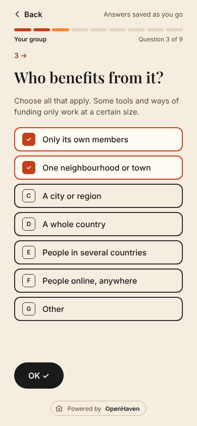
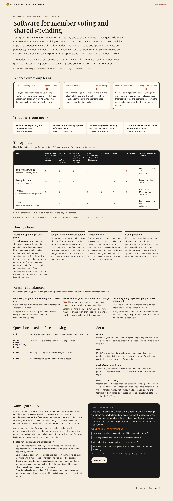
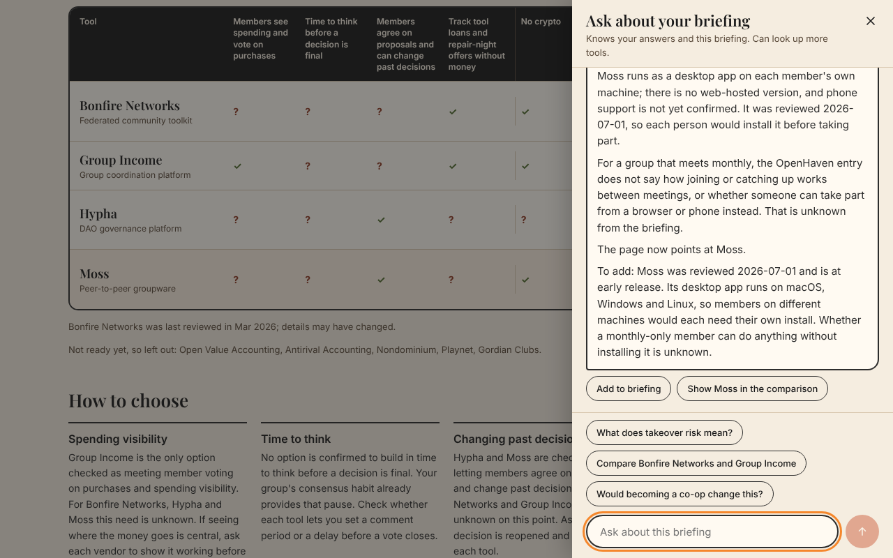

# Groundwork

Groundwork helps a group find open, community-run software that fits how it works. A group answers nine short questions about who it is, how it makes decisions and what it rules out, then asks one question. Groundwork compares the matching tools from [OpenHaven](https://openhaven.net)'s reviewed records and writes a briefing the group can share: the options side by side, the trade-offs between them, what is still unknown, and how to test a choice.

A [SuperBenefit](https://superbenefit.org) proof of concept. Live at **https://groundwork.superbenefit.dev**.

| Question | Briefing | Follow-up |
|---|---|---|
|  |  |  |

## What it does

- **Asks only what matters.** Nine questions, one per screen: size, who benefits, how decisions are made, three trade-offs (speed vs say, fixed vs changing rules, software vs judgement), what rules a tool out, who sets it up, legal form, then the question itself. Every choice has "Other".
- **Shows options, not a verdict.** Tools are listed alphabetically with ✓ confirmed, ✕ doesn't fit your answers, or ? unknown for each need and limit. Every ✓ and ✕ points to a reviewed field and its review date. Nothing is called best.
- **Says what to check.** Unknowns become questions to ask each project. Tools that break a limit are set aside with the reason.
- **Answers follow-up questions** about the briefing, leading with the answer, citing review dates and saying what is unknown. Answers can be kept in the briefing.
- **Remembers groups** in the browser, with no account: a returning visitor only types a new question.

## How it works

One Cloudflare Worker serves a static Astro site and two Durable Object agents. A research run takes about 15 seconds:

1. A decision model (Clef-flash) scores all 43 OpenHaven capabilities against the question.
2. Code matches tools across OpenHaven's 273 records, checks each against the group's limits and builds the comparison.
3. DeepSeek V4.1 Flash writes the prose around it, and a validator rejects anything that ranks, recommends or strays from the facts.

Details: [docs/ARCHITECTURE.md](docs/ARCHITECTURE.md).

## Develop

```bash
npm ci
```

```bash
npm run check
```

Push a branch to get a Preview at `https://<branch>-groundwork.superbenefit.workers.dev`. Previews are where research runs; see [docs/DEVELOPMENT.md](docs/DEVELOPMENT.md).

## Docs

| | |
|---|---|
| [ARCHITECTURE.md](docs/ARCHITECTURE.md) | How it works as built: agents, pipeline, models, limits, security, repository map |
| [DEVELOPMENT.md](docs/DEVELOPMENT.md) | Setup, previews, tests, the rules every change follows, common changes |
| [OPERATIONS.md](docs/OPERATIONS.md) | Production configuration, health checks, limits, cost, rollback |
| [evals/](docs/evals/) | How the models were chosen, with raw results |
| [design/](docs/design/) | The original product requirements and technical spec |
| [AGENTS.md](AGENTS.md) | Instructions for AI coding agents working in this repo |

## Credits

Tool data from [OpenHaven](https://openhaven.net), licensed CC BY-SA 4.0. Built on Cloudflare Workers, Durable Objects, the Agents SDK and Think, Workers AI, Astro and React.
